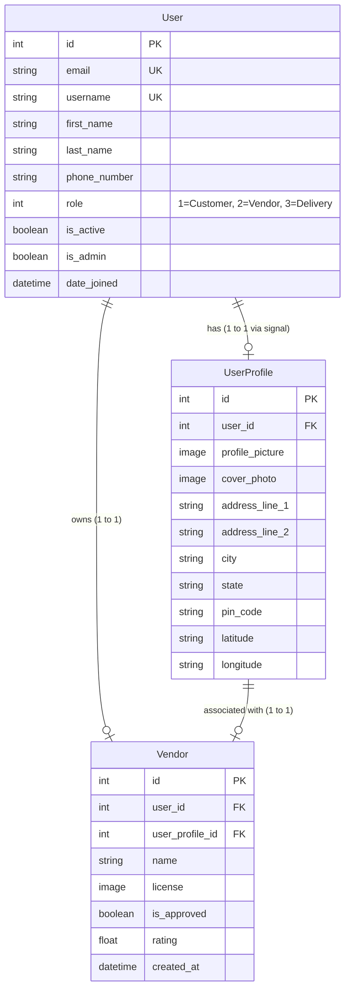
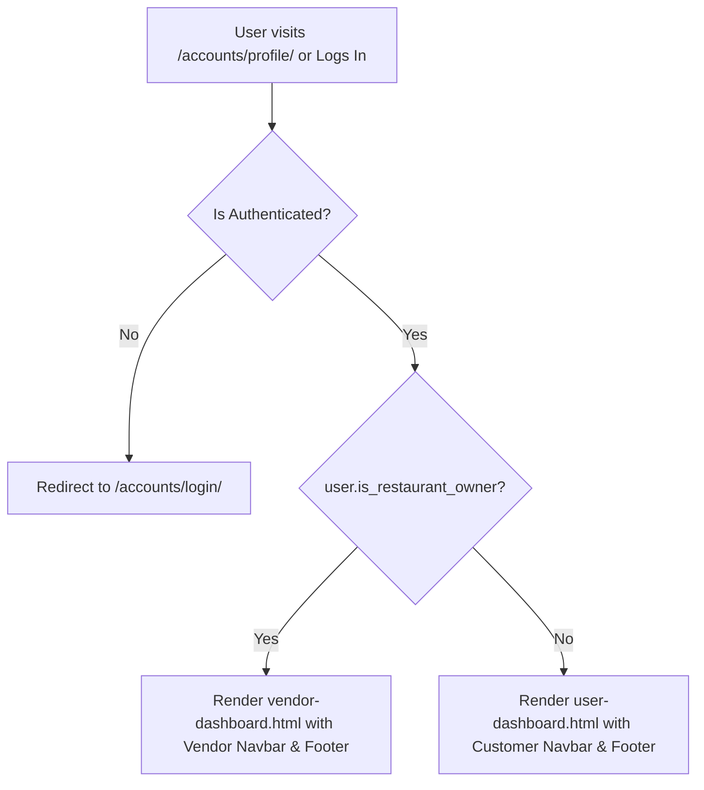

# Zayka — Multi-Vendor Food Delivery Platform
## Project Refresh & Comprehensive Documentation

*Last updated: November 2026*  
*Repository Root:* `E:\Projects\Projects\Zayka\zayka`

---

## 1. Executive Summary & Project Identity

**Zayka** is a multi-vendor online food ordering and delivery marketplace built using **Django** and **PostgreSQL**. The platform is designed around three distinct user roles:
1. **Customer:** Browse restaurants and categories, place orders, track deliveries, and manage account details.
2. **Restaurant Owner (Vendor):** Register restaurant profiles, submit legal documentation (license), manage menus, view analytics/orders, and toggle open/closed status.
3. **Delivery Personnel:** Driver role reserved for dispatch and delivery fulfilment.

Currently, core authentication, role-based registration, automated profile creation via signals, vendor registration with license upload, dual dynamic navigation systems, custom user administration, and responsive dashboards for both customers and vendors are implemented.

---

## 2. Git Commit Timeline & Development Progress

### Commit History
| Commit Hash | Commit Message | Date | Key Additions |
| :--- | :--- | :--- | :--- |
| `4ac335a` | **Initial Project Setup** | Apr 21, 2026 | Initial Django project layout (`zayka`), default `manage.py`, `.gitignore`. |
| `40d97ed` | **Postgres Configuration, Base Template and styling setup** | Apr 23, 2026 | PostgreSQL setup via `.env`, base styling (`static/main.css`), and initial `base.html`. |
| `73133ce` | **Custom User Model, Home and Register Templates** | Apr 28, 2026 | `accounts` app, custom `User` & `UserProfile` models, `UserManager`, `post_save` signals, `UserForm`, `CustomUserAdmin`, `RegisterUserView`, `register-user.html`. |
| `8083724` | **Vendor Registration added** | May 8, 2026 | `vendor` app, `Vendor` model, `VendorForm`, `VendorAdmin`, license upload handling, `register_vendor` view, `register-vendor.html`. |

---

### Uncommitted / In-Progress Working Tree Changes
Your workspace has significant enhancements made after the last commit:
1. **Authentication Views & Custom Login:**
   - Implemented `login` view with custom `LoginForm` (email-based auth widget).
   - Implemented POST-based `logout` view with session invalidation.
   - Implemented `profile` view (mapped to name `'dashboard'`) with role-based routing (`vendor-dashboard.html` vs `user-dashboard.html`).
2. **Componentized Template Architecture:**
   - Separated navbar and footer into `templates/includes/`:
     - `customer-navbar.html`
     - `customer-footer.html`
     - `vendor-navbar.html`
     - `vendor-footer.html`
   - `templates/base.html` conditionally renders vendor vs customer navigation based on `user.is_restaurant_owner`.
   - Added auto-dismiss JavaScript for alert messages (fades out after 4 seconds).
3. **Landing Page:**
   - Added full `templates/home.html` featuring hero banner, popular food categories (Biryani, North Indian, Street Food, etc.), "How It Works", value proposition, partner CTA, and mobile app download teasers.
4. **Dashboards & Views:**
   - Added `user-dashboard.html`: Customer order history, stats cards (Total Orders, Reviews, Zayka Cash), and account links.
   - Added `vendor-dashboard.html`: Store toggle switch, daily revenue, order pipeline (New, Preparing, Ready for pickup), accept/reject controls.
   - Created placeholder `pending-approval.html` for unapproved vendor accounts.
5. **Model Enhancements:**
   - `accounts/models.py`: Added `User.is_restaurant_owner()` method and updated `is_active` default to `False`.
   - `accounts/signals.py`: Robust error-handling for `UserProfile.DoesNotExist` in `create_profile`.
   - Set `related_name='user_profile'` on `UserProfile.user`.
6. **Placeholder Architecture (Empty files created):**
   - `accounts/decorators.py` (for role-based view restrictions).
   - `accounts/middleware.py` (for route-level role/approval interception).
   - `vendor/signals.py` (for vendor status trigger hooks).

---

## 3. Python Packages & Dependencies

### Currently Installed in Virtual Environment (`.\venv`)
| Package | Version | Purpose |
| :--- | :--- | :--- |
| **Django** | `6.1.3` | The primary high-level Python web framework powering the backend, ORM, templating, routing, and authentication. |
| **asgiref** | `3.13.0` | ASGI (Asynchronous Server Gateway Interface) specification and utilities standard for modern Django versions. |
| **sqlparse** | `0.6.1` | Non-validating SQL parser used internally by Django's database engine for inspecting and formatting queries. |
| **pip** | `26.2.2` | The package installer for Python. |

### Required Packages Missing in Virtual Environment
*Note: Your code in `settings.py` and `models.py` imports these libraries, but they need to be reinstalled in the virtual environment:*

| Package | Import in Code | Purpose |
| :--- | :--- | :--- |
| **python-decouple** | `from decouple import config` (`zayka/settings.py:14`) | Safely organizes configuration parameters (e.g. `SECRET_KEY`, `DEBUG`, database credentials) outside the code in `.env`. |
| **python-dotenv** | `from dotenv import load_dotenv` (`zayka/settings.py:13`) | Reads key-value pairs from `.env` and sets them as environment variables. |
| **psycopg2** / **psycopg2-binary** | `'ENGINE': 'django.db.backends.postgresql'` (`zayka/settings.py:85`) | PostgreSQL database adapter required for Django to communicate with your PostgreSQL database. |
| **Pillow** | `models.ImageField` (`accounts/models.py`, `vendor/models.py`) | Python Imaging Library needed by Django to validate, resize, and save images uploaded to `ImageField` (`profile_picture`, `cover_photo`, `license`). |

#### Reinstallation Command
To reinstall all missing dependencies into the active environment:
```powershell
.\venv\python.exe -m pip install python-decouple python-dotenv psycopg2-binary pillow
```

---

## 4. Directory Structure

```
zayka/
│
├── .env                              # Local environment variables (DB credentials, SECRET_KEY, DEBUG)
├── .env-sample                       # Sample environment file template
├── .gitignore                        # Git ignore patterns (venv, media, cache, .env)
├── db.sqlite3                        # Initial default SQLite file (inactive; PostgreSQL is configured)
├── manage.py                         # Django administrative CLI runner
│
├── zayka/                            # Core Project Configuration App
│   ├── __init__.py
│   ├── asgi.py                       # ASGI entrypoint for async server deployments
│   ├── wsgi.py                       # WSGI entrypoint for web server deployment
│   ├── settings.py                   # Master settings (DB, Installed Apps, Middleware, Templates, Media/Static)
│   └── urls.py                       # Root URL dispatcher (routes '/', '/admin/', and '/accounts/')
│
├── accounts/                         # User & Authentication App
│   ├── admin.py                      # Custom User & UserProfile Django Admin configuration
│   ├── apps.py                       # App configuration & signal registration
│   ├── decorators.py                 # Placeholder for custom auth/role decorators
│   ├── forms.py                      # UserCreationForm (UserForm) & AuthenticationForm (LoginForm)
│   ├── middleware.py                 # Placeholder for role/approval routing middleware
│   ├── models.py                     # Custom User (AbstractBaseUser), UserManager, UserProfile
│   ├── signals.py                    # post_save signal to auto-create/update UserProfile
│   ├── tests.py                      # Test suite placeholder
│   ├── urls.py                       # Accounts URL routes (register, login, logout, profile)
│   ├── views.py                      # View functions & classes for registration, login, logout, dashboard
│   ├── migrations/                   # Database schema migrations
│   │   ├── 0001_initial.py           # Creates initial User table
│   │   ├── 0002_alter_user_role.py   # Makes user role nullable/blankable
│   │   └── 0003_userprofile.py       # Creates UserProfile table linked to User
│   └── templates/accounts/           # Accounts templates
│       ├── login.html                # Custom split-screen login page
│       ├── pending-approval.html     # Placeholder for pending vendor approval notification
│       ├── register-user.html        # Customer registration form
│       ├── register-vendor.html      # Restaurant registration form + license upload
│       ├── user-dashboard.html       # Customer dashboard & order history
│       └── vendor-dashboard.html     # Restaurant dashboard & order management
│
├── vendor/                           # Restaurant / Vendor App
│   ├── admin.py                      # Vendor model admin registration & configuration
│   ├── apps.py                       # Vendor app configuration
│   ├── forms.py                      # VendorForm (ModelForm for name & license upload)
│   ├── models.py                     # Vendor model (one-to-one with User & UserProfile)
│   ├── signals.py                    # Placeholder for vendor-specific signals
│   ├── tests.py                      # Test suite placeholder
│   ├── views.py                      # Views placeholder for vendor-specific functionality
│   └── migrations/
│       └── 0001_initial.py           # Creates Vendor table
│
├── static/                           # Global Static Assets
│   └── main.css                      # Unified stylesheet (theme colors, cards, forms, dashboards, alerts)
│
├── media/                            # User Uploaded Content
│   ├── users/                        # Destination for profile pictures & cover photos
│   └── vendor/license/               # Destination for uploaded restaurant licenses
│
└── templates/                        # Global Templates
    ├── base.html                     # Root HTML skeleton, font loading, auto-alert JS, dynamic navbar/footer
    ├── home.html                     # Landing homepage (hero, category carousel, CTA sections)
    └── includes/                     # Modular template components
        ├── customer-navbar.html      # Navbar with search, cart badge, customer links
        ├── customer-footer.html      # Footer with customer links, partner portal link
        ├── vendor-navbar.html        # Partner navbar with restaurant open/close toggle
        └── vendor-footer.html        # Partner footer with vendor guidelines & help center
```

---

## 5. Exhaustive Function, Class & Method Documentation

### 5.1 `accounts/models.py`

#### `class UserManager(BaseUserManager)`
Custom model manager for the `User` model, overriding standard user creation logic to use email instead of username for primary identification.
* **`create_user(self, first_name, last_name, username, email, password=None)`**
  * *Purpose:* Validates that `email` and `username` exist, normalizes the email, creates the `User` instance, hashes the password via `set_password()`, saves to the active database, and returns the newly created user object.
* **`create_superuser(self, first_name, last_name, username, email, password=None)`**
  * *Purpose:* Leverages `create_user()` to instantiate a user, elevates permission flags (`is_admin = True`, `is_staff = True`, `is_superadmin = True`), saves, and returns the superuser.

#### `class User(AbstractBaseUser)`
Custom user entity extending Django's `AbstractBaseUser`.
* *Attributes & Fields:*
  * `CUSTOMER = 1`, `RESTAURANT_OWNER = 2`, `DELIVERY_PERSONNEL = 3`: Role constants.
  * `ROLE_CHOICES`: Tuple mapping role IDs to human-readable labels.
  * `first_name` (`CharField`, max 50), `last_name` (`CharField`, max 50).
  * `username` (`CharField`, max 50, unique).
  * `email` (`EmailField`, max 100, unique, used as `USERNAME_FIELD`).
  * `phone_number` (`CharField`, max 12, blank).
  * `role` (`PositiveSmallIntegerField`, choices=`ROLE_CHOICES`, nullable).
  * `is_active` (`BooleanField`, default=`False`): Determines if user can authenticate (set to False for activation/verification workflows).
  * `is_staff`, `is_admin`, `is_superadmin` (`BooleanField`).
  * `date_joined`, `last_login`, `created_at`, `updated_at` (`DateTimeField`).
* *Methods:*
  * **`__str__(self)`**: Returns user's email address.
  * **`has_perm(self, perm, obj=None)`**: Returns `is_admin` to satisfy Django admin permission checks.
  * **`has_module_perms(self, app_label)`**: Returns `True` allowing access to app labels within Django admin.
  * **`is_restaurant_owner(self)`**: Helper returning boolean `True` if `self.role == self.RESTAURANT_OWNER`. Used in templates to toggle vendor navbars/footers.

#### `class UserProfile(models.Model)`
Stores complementary profile and geographic data for a user.
* *Attributes & Fields:*
  * `user` (`OneToOneField` to `User`, `related_name='user_profile'`).
  * `profile_picture` (`ImageField`, upload path: `users/profile_pictures`).
  * `cover_photo` (`ImageField`, upload path: `users/cover_photos`).
  * `address_line_1`, `address_line_2` (`CharField`, max 50).
  * `country`, `state`, `city` (`CharField`, max 15).
  * `pin_code` (`CharField`, max 6).
  * `latitude`, `longitude` (`CharField`, max 20) for future map/geolocation tracking.
  * `created_at`, `updated_at` (`DateTimeField`).
* *Methods:*
  * **`__str__(self)`**: Returns `self.user.email`.

---

### 5.2 `accounts/views.py`

#### **`def home(request)`**
* *Route:* `/` (`name='home'`)
* *Purpose:* Renders the main customer landing page (`templates/home.html`).

#### **`class RegisterUserView(View)`**
Class-based view managing customer registration.
* *Route:* `/accounts/register/user/` (`name='register-user'`)
* *Methods:*
  * **`get(self, request)`**: Checks if visitor is already authenticated. If yes, displays an informational message and redirects to `dashboard`. If not, renders `accounts/register-user.html` with an empty `UserForm`.
  * **`post(self, request)`**: Validates submitted `UserForm`. On success, commits the record with `user.role = User.CUSTOMER`, saves, shows success message `"User registered successfully!"`, and redirects back to register. If form is invalid, re-renders the template with field-specific errors.

#### **`def register_vendor(request)`**
Function-based view managing restaurant vendor onboarding.
* *Route:* `/accounts/register/vendor/` (`name='register-vendor'`)
* *Purpose:*
  * If user is authenticated and already a `RESTAURANT_OWNER`, redirects to `dashboard`.
  * Instantiates both `UserForm` (for credentials and basic info) and `VendorForm` (for restaurant name and license image via `request.FILES`).
  * If both forms are valid:
    1. Saves user with `user.role = User.RESTAURANT_OWNER`.
    2. Retrieves the newly created `user.user_profile` (created automatically by the signal).
    3. Saves `Vendor` record with foreign keys set to `user` and `user_profile`.
    4. Posts success message `"Vendor registered successfully! Please wait for approval."` and redirects to `dashboard`.
  * Renders `accounts/register-vendor.html`.

#### **`def login(request)`**
* *Route:* `/accounts/login/` (`name='login'`)
* *Purpose:*
  * Checks if user is authenticated; if so, redirects to `dashboard`.
  * Instantiates custom `LoginForm(request, data=request.POST or None)`.
  * When submitted and valid, calls `form.get_user()`.
  * Verifies `user is not None and user.is_active`.
  * Invokes `auth_login(request, user)` to establish user session, displays success message, and redirects to `dashboard`.
  * Renders `accounts/login.html`.

#### **`def logout(request)`**
* *Route:* `/accounts/logout/` (`name='logout'`)
* *Purpose:*
  * Validates that user is authenticated and request method is `POST` (preventing CSRF logout attacks).
  * Calls `auth_logout(request)` to terminate the Django session.
  * Displays an info message and redirects to `login`.

#### **`def profile(request)`**
* *Route:* `/accounts/profile/` (`name='dashboard'`)
* *Purpose:*
  * Acts as the unified post-login dashboard dispatcher.
  * If user is unauthenticated, emits error message and redirects to `login`.
  * If user is a restaurant owner (`request.user.is_restaurant_owner()`), renders `accounts/vendor-dashboard.html`.
  * Otherwise, renders customer dashboard `accounts/user-dashboard.html`.

---

### 5.3 `accounts/forms.py`

#### `class UserForm(UserCreationForm)`
* *Purpose:* Customizes Django's built-in `UserCreationForm` to register new users with customized HTML input widgets.
* *Fields:* `first_name`, `last_name`, `username`, `email`, `phone_number`, `password1`, `password2`.
* *Custom Widgets:* Applied CSS classes (`form-control`), unique IDs, and placeholders for easy styling and FontAwesome icon integration.

#### `class LoginForm(AuthenticationForm)`
* *Purpose:* Customizes Django's `AuthenticationForm` so that the default `username` input is rendered as an HTML `EmailInput` with placeholder `"Email Address"` while preserving Django's internal authentication machinery.
* *Methods:*
  * **`__init__(self, *args, **kwargs)`**: Calls `super().__init__()` and overrides `self.fields['username'].widget` and `self.fields['password'].widget` with customized CSS classes and attributes.

---

### 5.4 `accounts/signals.py`

#### **`@receiver(post_save, sender=User) def create_profile(sender, instance, created, **kwargs)`**
* *Trigger:* Executes automatically whenever a `User` instance is saved.
* *Logic:*
  * If `created == True`: Automatically creates a matching `UserProfile.objects.create(user=instance)`.
  * If `created == False` (existing user update): Fetches the existing `UserProfile` for that user and saves it. If for any reason the profile did not exist, catches `UserProfile.DoesNotExist` and creates one.

---

### 5.5 `accounts/admin.py`

#### `class CustomUserAdmin(UserAdmin)`
* *Purpose:* Customizes the Django Admin panel for the `User` model.
* *Attributes:*
  * `add_form = UserForm`: Uses custom user form when creating users from the admin.
  * `list_display`: Displays `('email', 'username', 'first_name', 'last_name', 'role', 'is_active')`.
  * `ordering = ('-date_joined',)`: Orders newest registrations first.
  * `add_fieldsets`: Custom layout for adding users through the admin interface.

---

### 5.6 `accounts/apps.py`

#### `class AccountsConfig(AppConfig)`
* *Attributes:* `name = 'accounts'`
* *Methods:*
  * **`ready(self)`**: Imports `accounts.signals` to ensure signal listeners are registered when Django starts up.

---

### 5.7 `vendor/models.py`

#### `class Vendor(models.Model)`
Represents restaurant businesses registered on the platform.
* *Attributes & Fields:*
  * `user` (`OneToOneField` to `User` with `CASCADE`): Links vendor directly to its login account.
  * `user_profile` (`OneToOneField` to `UserProfile` with `CASCADE`): Links vendor to the owner's profile info.
  * `name` (`CharField`, max 50): Restaurant business name.
  * `license` (`ImageField`, upload path: `vendor/license`): Legal trade/food safety license document image.
  * `is_approved` (`BooleanField`, default=`False`): Admin approval status flag. Unapproved vendors should not be publicly listed.
  * `created_at`, `modified_at` (`DateTimeField`).
  * `rating` (`FloatField`, default=0.0, validated between 0.0 and 5.0 via `MinValueValidator` and `MaxValueValidator`).
* *Methods:*
  * **`__str__(self)`**: Returns `self.name` (the restaurant name).

---

### 5.8 `vendor/forms.py`

#### `class VendorForm(forms.ModelForm)`
* *Purpose:* Used on the vendor registration page to collect restaurant-specific fields.
* *Model:* `Vendor`
* *Fields:* `['name', 'license']`
* *Widgets:*
  * `name`: `TextInput` with placeholder `"Tasty Bites"` and id `"restaurant_name"`.
  * `license`: `FileInput` with id `"license"`.

---

### 5.9 `vendor/admin.py`

#### `class VendorAdmin(admin.ModelAdmin)`
* *Purpose:* Admin configuration for managing partner restaurants.
* *Attributes:*
  * `list_display = ('user', 'name', 'is_approved')`: Immediate visual check on owner, restaurant name, and verification status.
  * `list_filter = ('is_approved',)`: Filter approved vs pending vendors.
  * `search_fields = ('user__email', 'name')`: Quick search by owner email or restaurant name.
  * `readonly_fields = ("rating",)`: Prevents manual alteration of calculated ratings.

---

### 5.10 `vendor/apps.py`

#### `class VendorConfig(AppConfig)`
* *Attributes:* `name = 'vendor'`

---

### 5.11 `zayka/urls.py` & `accounts/urls.py`

#### Root URLs (`zayka/urls.py`)
1. `path('', accounts_views.home, name='home')`: Root landing page.
2. `path('admin/', admin.site.urls)`: Django Admin portal.
3. `path('accounts/', include('accounts.urls'))`: Delegates accounts namespace.
4. Static media serving: `+ static(settings.MEDIA_URL, document_root=settings.MEDIA_ROOT)`.

#### Accounts URLs (`accounts/urls.py`)
1. `path('register/user/', views.RegisterUserView.as_view(), name='register-user')`
2. `path('register/vendor/', views.register_vendor, name='register-vendor')`
3. `path('login/', views.login, name='login')`
4. `path('logout/', views.logout, name='logout')`
5. `path('profile/', views.profile, name='dashboard')`

---

## 6. Architecture & Data Flow

### Entity-Relationship Diagram



### Authentication & Dashboard Routing Flow



---

## 7. Current Project Status & Immediate Next Steps

### What Works Now
- Full custom authentication system (`AbstractBaseUser` with email login).
- Automated profile generation via Django `post_save` signals.
- Multi-form vendor registration (handling file uploads for business licenses).
- Role-based separation in views, dashboards, and navigational headers/footers.
- Modern CSS design system with responsive layouts, alert auto-dismiss, and dashboard stat cards.

### Incomplete or Pending Tasks
1. **Reinstall Python Environment Dependencies:**
   - Execute: `pip install python-decouple python-dotenv psycopg2-binary pillow`
2. **Database Migrations:**
   - Run `python manage.py makemigrations` and `python manage.py migrate` on PostgreSQL.
   - Note: In `accounts/models.py`, `is_active` default was changed to `False` and `related_name='user_profile'` was added, which require a new migration file.
3. **User Activation / Verification:**
   - Because `is_active` is set to `False` by default in `accounts/models.py`, newly registered users currently cannot log in until activated. Implement email verification tokens or admin activation.
4. **Vendor Approval Enforcement:**
   - Populate `accounts/decorators.py` or `accounts/middleware.py` to check `vendor.is_approved`. If `is_approved == False`, redirect the restaurant owner to `accounts/templates/accounts/pending-approval.html`.
5. **Next Milestone Modules:**
   - Menu Management (`Category`, `FoodItem` models and CRUD views).
   - Customer Marketplace (Restaurant listing, menu view, cart session management).
   - Order Processing & Payment Integration (Razorpay / Stripe / Cash on Delivery).
